# Decompiling a SM64DS class C++ function in Ghidra 12.0.4

To decompile a Super Mario 64 DS (SM64DS) class C++ function using Ghidra 12.0.4, follow these steps:

1. **Set Up Ghidra**: Ensure you have Ghidra 12.0.4 installed on your system. You can download it from the official Ghidra GitHub repository.
2. **Request access from the maintainers**: Due to security concerns, access for writing the project is restricted. Read-only is more easy to familiarize yourself with the code before making any changes. Just request Andrew (opie-x, one of our core maintainers) a role.
3. **Navigate to the Function**: Once the connection to the server is complete, navigate to the function you want to decompile. You can do this by using the Symbol Tree or by searching for the function name if you have symbol information available. They're in the [config/tu_manifest.d](https://github.com/tangosdev/sm64ds-decomp/tree/main/config/tu_manifest.d) directory of the decompilation project. For example, if you want to decompile the `dCc_c::Process` function, you can find it in the [config/tu_manifest.d/arm9/dCc_c.json](https://github.com/tangosdev/sm64ds-decomp/blob/main/config/tu_manifest.d/arm9/dCc_c.json) file.
4. **Decompile the Function**: Right-click on the function and select "Disassemble - Arm" to view the decompiled code in the listing and decompiler window.
5. **Analyze and Refine**: Analyze the decompiled code and make any necessary adjustments or refinements to improve its readability and accuracy.

Our example function `dCc_c::Process` is located in the directory `src\engine\collision\d_cc.cpp`, [https://github.com/tangosdev/sm64ds-decomp/blob/main/src/engine/collision/d_cc.cpp#L100](https://github.com/tangosdev/sm64ds-decomp/blob/main/src/engine/collision/d_cc.cpp#L100).

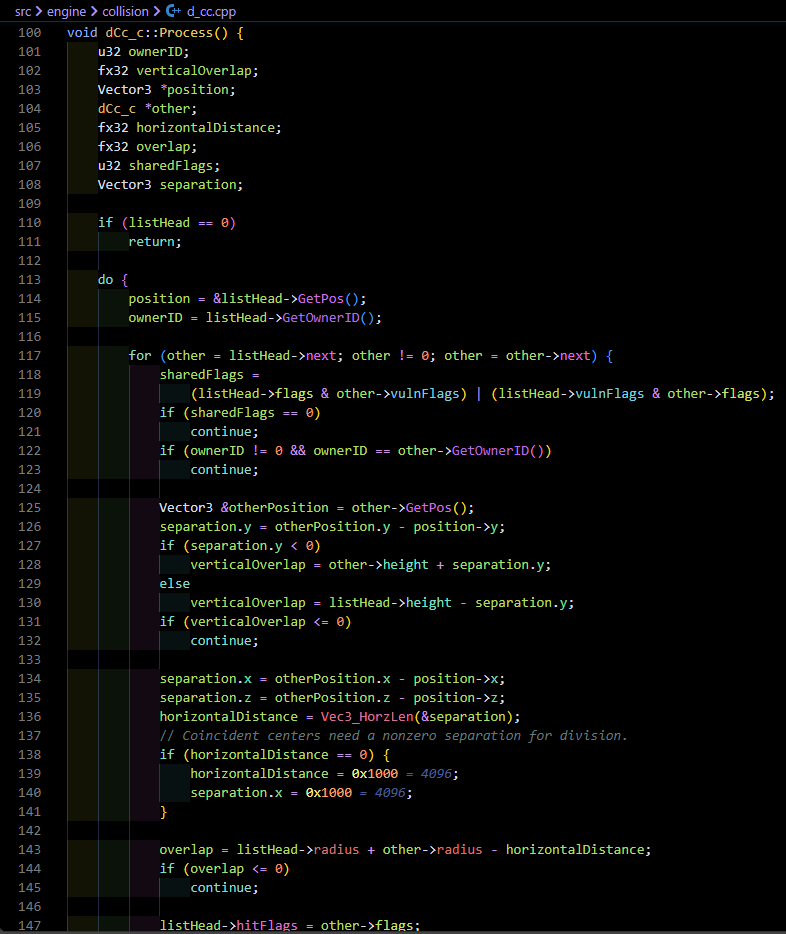

 You can find the relevant code snippet below:
```cpp
void dCc_c::Process() {
function_body_here...
}
```

Back to Ghidra, the listing and decompiler windows will show the disassembled and decompiled code for the `dCc_c::Process` function. You can analyze the code, identify variables, and **try to understand while matching** the decompiled code with the reconstructed source to understand the logic implemented in the function.

Default Listing view for `func_02014aa8` (`dCc_c::Process`) in Ghidra:

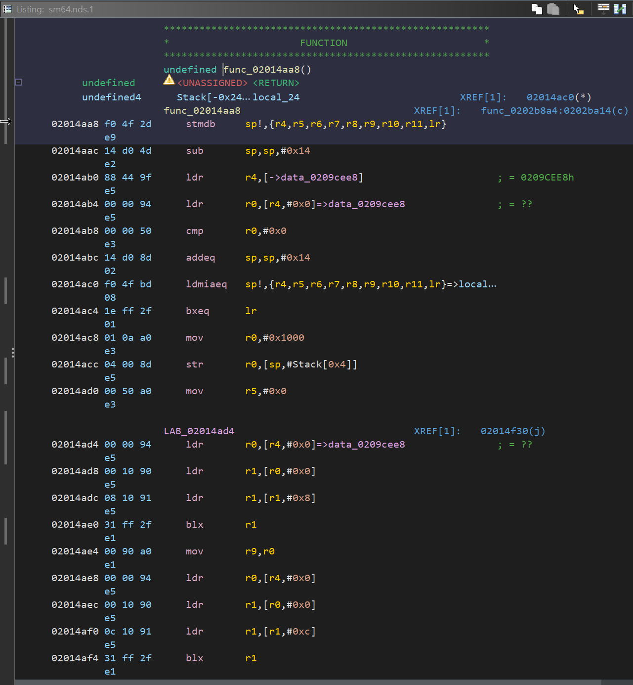

Default Decompiler view for `func_02014aa8` (`dCc_c::Process`) in Ghidra:

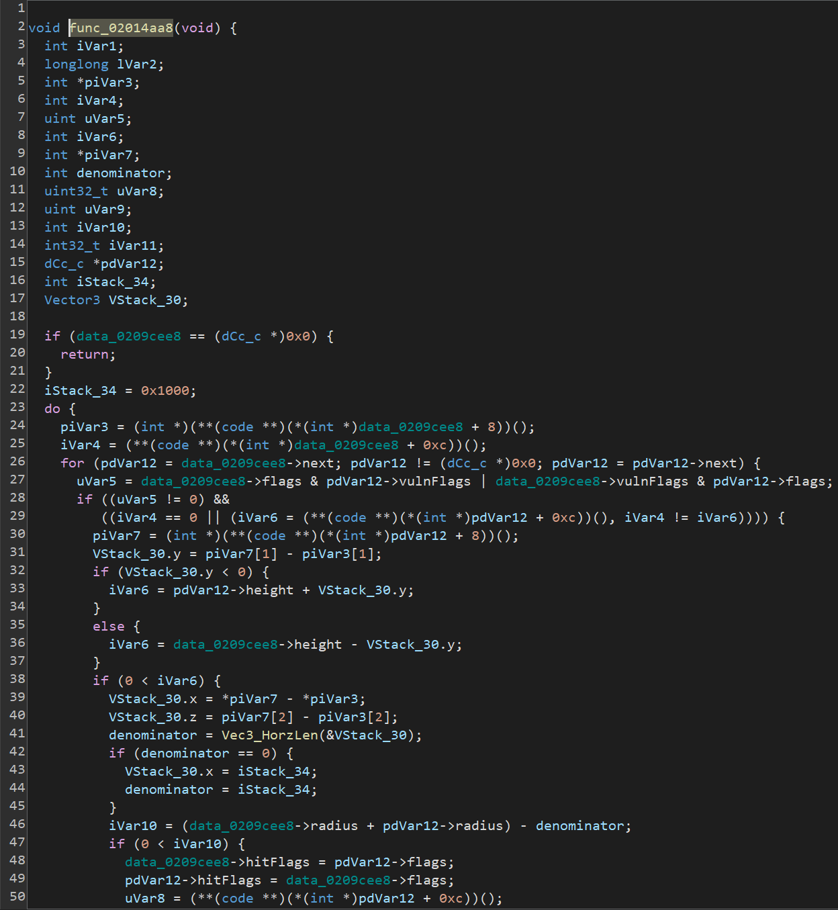

You might think that the decompiled code is not very readable initially (within reason, that's a fine mess!), but you can improve it by renaming variables and functions, adding comments, and using Ghidra's features to enhance the decompilation output. This will help you better understand the function's logic and how it fits into the overall program. 

Let's take a look at setting up the preparation for function matching and renaming in Ghidra. Reviewing the decompiled source:
```cpp
void dCc_c::Process()
```
We see the `::` scope-resolution operator, which indicates that `Process` is a member function of the `dCc_c` class. This is a common pattern in C++ for defining class methods. Of course, we'll need to create the corresponding class in Ghidra to match this function properly.

## Creating the `dCc_c` class in Ghidra and Editing the Function

To create the `dCc_c` class in Ghidra, follow these steps:

- In the Ghidra Code Browser, navigate to the "Symbol Tree" window. You can open it by going to "Window" > "Symbol Tree" in the menu bar.
- Right-click on the "Classes" node in the Symbol Tree and select "Create Class" from the context menu.

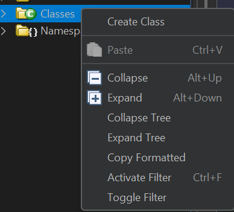

A option will appear to enter the new class name with the default being `NewClass`. Type `dCc_c` and ENTER to create it. It should look like this in the Symbol Tree:


Now we're ready to edit the function, press `F` in the listing window to open the "Function Edit" dialog. In the textbox, change the name from `func_02014aa8` to `Process`. In the "Return Type" field, change it from `undefined` to `void`.

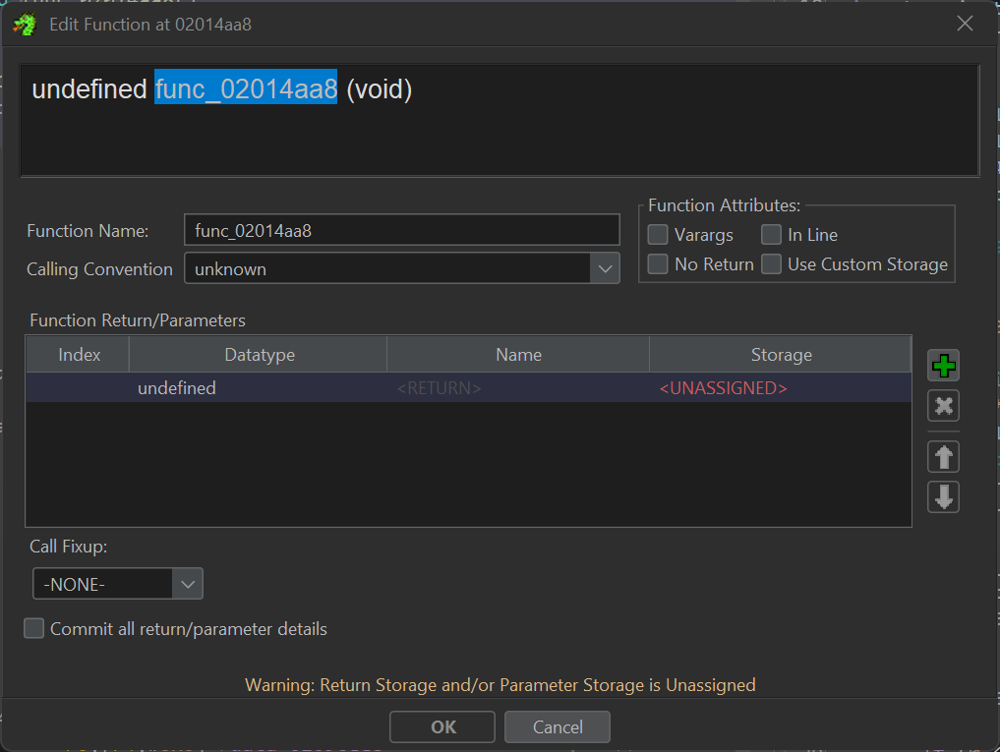

We're not done yet; the scope resolution operator will be used to indicate that `Process` is a member function of the `dCc_c` class. `this` is a pointer to the current instance of the class, and it is passed as an implicit parameter to member functions. However, in this function we set the `Calling Convention` to `__stdcall` due to it being the default calling convention for member functions in C++. Ghidra will use this when the `__thiscall` isn't selected.

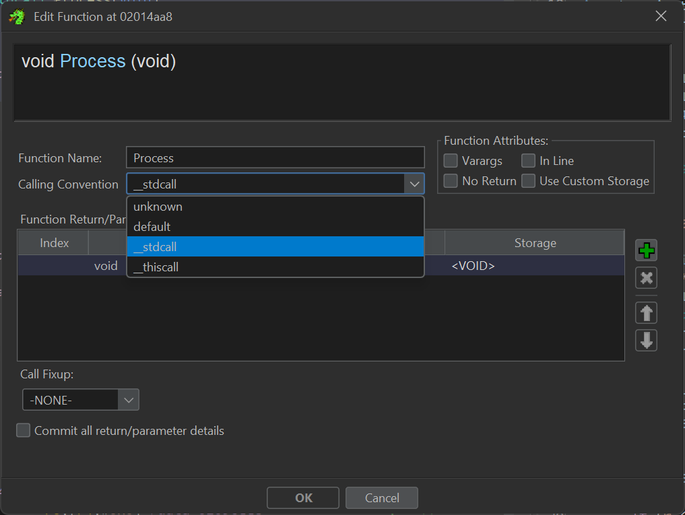

### Setting the Class reference

In the `Symbol Tree`, open the function panel to list all the functions in the program. You can do this by going to "Window" > "Functions" in the menu bar. For easier organization, Ghidra sets all of them in folders alphabetically by default. 


You can find our renamed `Process` function in the list, we can select it, and let's drag it all the way to the `dCc_c` class in the `Symbol Tree`. This will set the class reference for the function, indicating that it is a member of the `dCc_c` class.


The changes are reflected in the `Listing` and `Decompiler` windows, where the function is now correctly identified as a member of the `dCc_c` class, by virtue of the scope resolution operator `::`. The decompiled code will now show `dCc_c::Process()` instead of just `Process()`, making it clear that this function belongs to the `dCc_c` class.

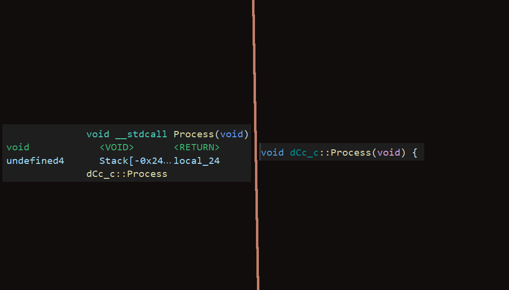

## Renaming Decompiled Function Variables

Now we can actually start renaming variables! Take this case for example, the decompiled code shows a variable named `denominator`, which does not make much sense in the context of the function. We can rename it to something more meaningful based on our understanding of the function's source logic.

Look: 

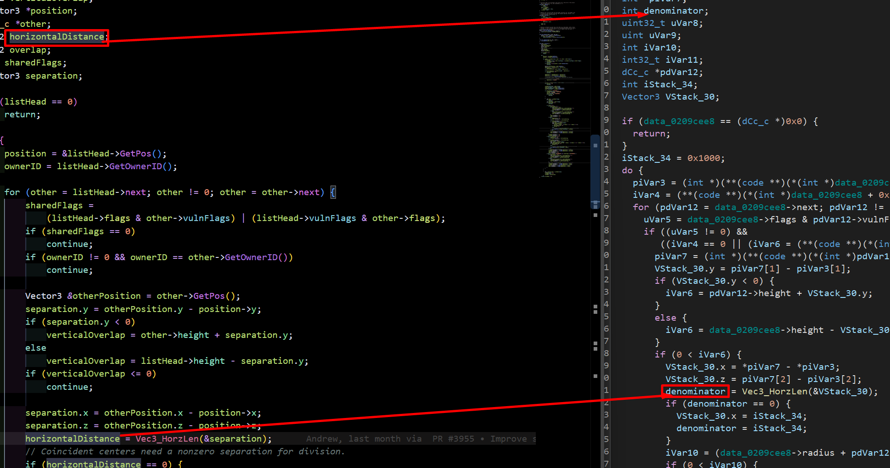

With `L` we can rename the local variable to `horizontalDistance`:

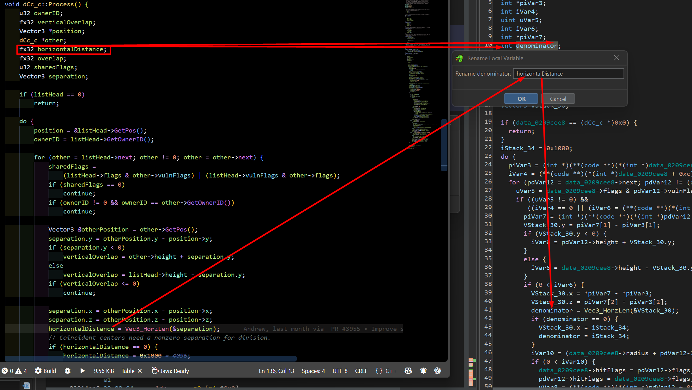

`CTRL+L` allows retyping the data type of the variable. In this case, we can change it from `int` to `fx32`, which is more appropriate for a variable representing a distance.

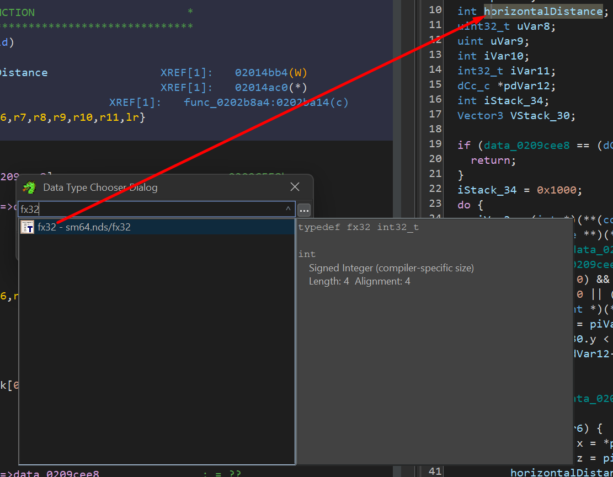

For another variable case, also rename `VStack_30` to `separation`. Lucky for us, data type is correct here. One plus, the variable can be inferred to really be a separation distance between two objects in the game world:

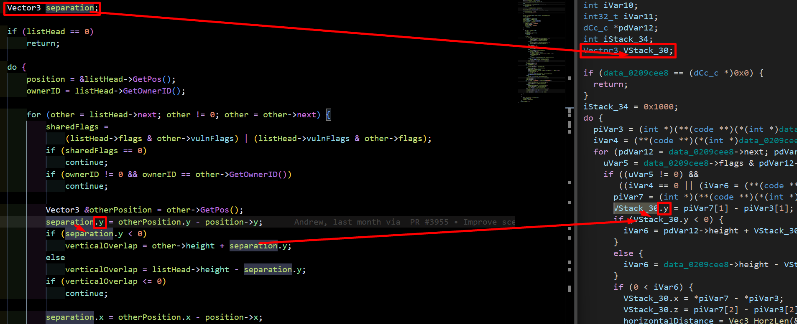

`Ghidra` *auto*-decompiled source:

```cpp
VStack_30.y = piVar7[1] - piVar3[1];
```

Is directly analogous to the human reconstructed source at `VS Code IDE`:

```cpp
separation.y = otherPosition.y - position->y;
```

But we're not done yet! We can turn our attention to the `Listing` window and see our `separation` variable has a `undefined[12]` data type.

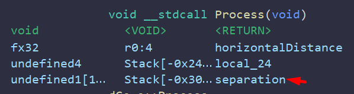

We can change it to `Vector3` which is a universal project struct representing a 3D vector in the game. Right-click on the variable and select "Set Data Type" > "Choose Data Type..." from the context menu. In the "Choose Data Type" dialog, type `Vector3` and click "OK" or select it in the dropdown.

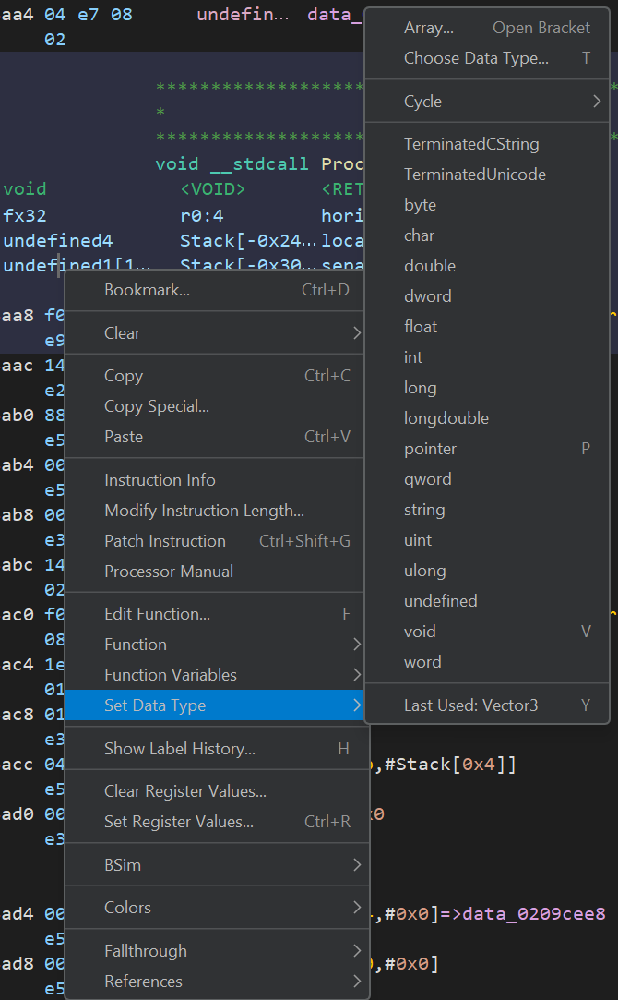

## Exposing hidden local functions variables in Listing and Decompiler windows

The `other` variable, in Ghidra being `pdVar12`, which also serves as an example to show an important implicit, not directly stated feature, that being gradual exposing of decompiled local function variables.

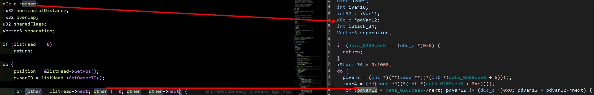

We see, `other` is a pointer to `dCc_c` class, being declared at the function start. However, scrolling to the end:

**CORRECT**;
```cpp
{
            dCc_c *nextCollider = listHead->next;
            listHead->prev = 0;
            listHead->next = 0;
            listHead = nextCollider;
        }
```

We see another pointer, `nextCollider`, which is also a pointer to `dCc_c` class! In the IDE source, it's declared at the end, however in Ghidra's decompiler, it's exposed in the variable list at the function top, which presents *all* of the global used variables for that func only.

Problem is, it's hidden in the decompiled code! Scrolling to the end of the function, we see instead `other` incorrectly being used as `nextCollider`, this is how it would look as source code in the IDE:

**INCORRECT**;
```cpp
{
            dCc_c *other = listHead->next;
            listHead->prev = 0;
            listHead->next = 0;
            listHead = other;
        }
```
What in Ghidra once incorrectly was:
```cpp
    other = data_0209cee8->next;
    data_0209cee8->prev = (dCc_c *)0x0;
    data_0209cee8->next = (dCc_c *)0x0;
                    // WARNING: Read-only address (ram,0x0209cee8) is written
    data_0209cee8 = other;
    if (other == (dCc_c *)0x0) {
      return;
    }
```

Now turns into:
```cpp
    pdVar10 = data_0209cee8->next;
    data_0209cee8->prev = (dCc_c *)0x0;
    data_0209cee8->next = (dCc_c *)0x0;
                    // WARNING: Read-only address (ram,0x0209cee8) is written
    data_0209cee8 = pdVar10;
    if (pdVar10 == (dCc_c *)0x0) {
      return;
    }
```
All instances of `other` were unaffected, and now we can properly rename `pdVar10`, it's own entity|variable, to `nextCollider`, and the decompiled code will match the IDE source code.

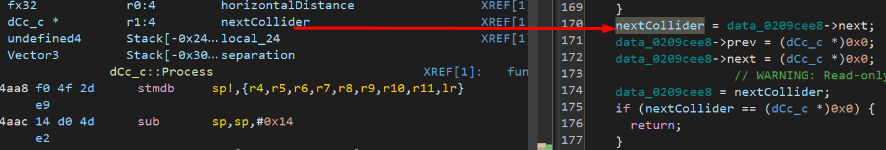